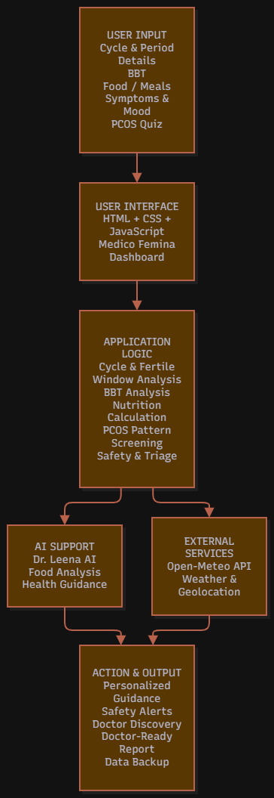

# Medico-Femina
Medico Femina empowers women to take control of their endocrine health through daily micro-habits, actionable biofeedback, and compassionate clinical guidance—transforming the overwhelming experience of PCOD/PCOS into a structured, sustainable journey toward lifelong hormonal remission.

## 🏗️ System Architecture

Medico Femina follows a browser-first architecture that processes user health inputs through tracking, analysis, AI support, and safety modules.
### Architecture Flow

### Architecture Flow

User Input

↓

HTML/CSS/JavaScript Interface

↓

Application Logic

↓

AI & Safety Modules

↓

External Services

↓

Guidance, Alerts & Doctor Support

video link: https://drive.google.com/file/d/17-RnepG1WbmSO5_R_sqV8NA0G9hduPQ_/view?usp=drivesdk

Future Scope

• Personalized health insights
• Improved AI-based pattern analysis
• Wearable device integration
• Period prediction improvements
• Advanced nutrition recommendations
• Multilingual support
• Voice-based AI assistant
• Doctor appointment integration
• Health report generation
• Secure cloud synchronization
